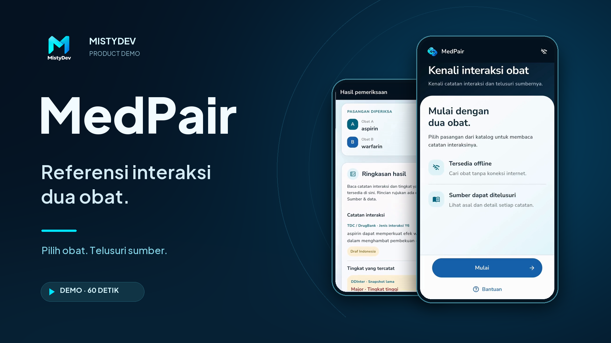
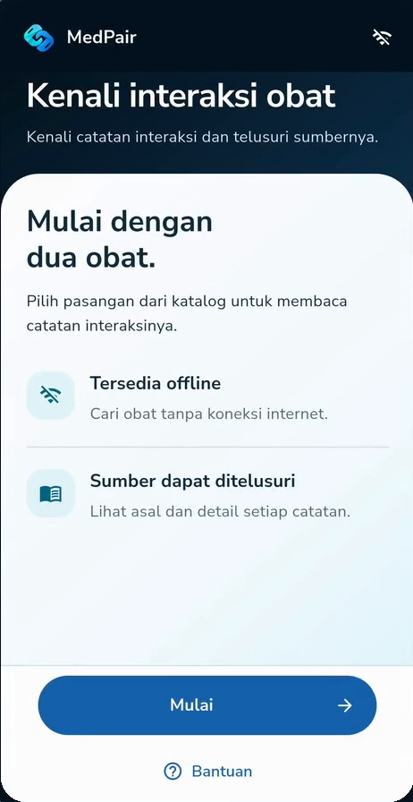
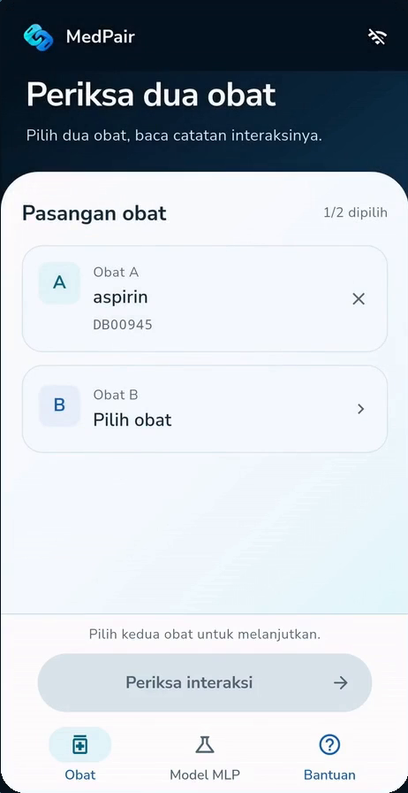
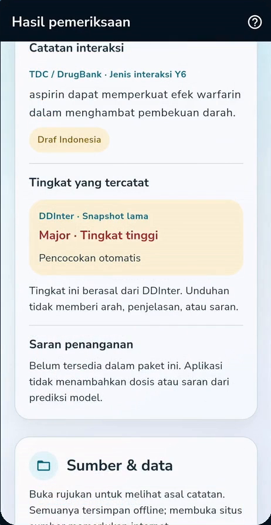
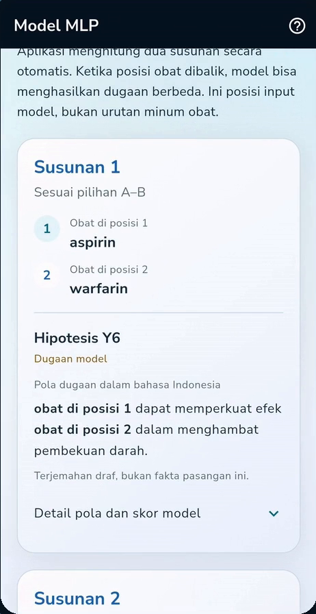
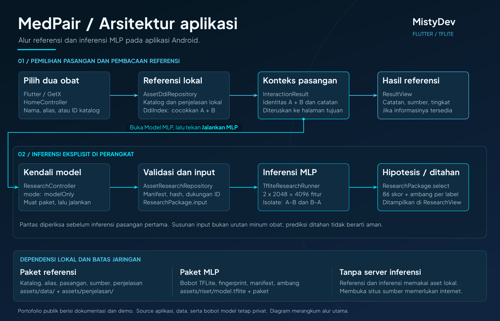

# MedPair

**Referensi interaksi dua obat, dari MistyDev.**

MedPair adalah prototipe Android untuk menelusuri catatan interaksi dua obat beserta sumbernya. Aplikasi juga menyediakan model MLP di perangkat, dengan keluaran yang ditampilkan sebagai hipotesis melalui jalur tersendiri.

Repositori publik ini berisi **dokumentasi, media demo, dan arsitektur MedPair**. Source aplikasi dan tes dipertahankan secara lokal. Dataset, paket referensi, bobot model, dan APK tidak disertakan dalam repo publik.

[Arsitektur](docs/ARSITEKTUR.md) · [Studi kasus](docs/STUDI-KASUS.md) · [Asal media](docs/MEDIA.md)

**[Lihat / unduh demo MP4 dengan subtitle Indonesia](assets/medpair-demo.mp4?raw=true)** · 59,8 detik · 1920 × 1080

Video memperlihatkan penggunaan aplikasi yang direkam langsung dari HP, dengan narasi dan subtitle Indonesia. Materi demo dapat ditinjau tanpa memasang aplikasi.

**APK untuk unduhan publik belum disediakan.** Paket distribusi masih perlu melalui pemeriksaan isi dan izin data/model sebelum dapat dibagikan.

## Alur aplikasi

1. **Pilih dua obat** dari katalog melalui pencarian nama, alias, atau ID.
2. **Buka catatan referensi** untuk membaca ringkasan, tingkat yang tersedia, dan asal sumber.
3. **Jalankan model secara eksplisit** melalui halaman **Model MLP** dan tombol **Jalankan MLP**.
4. **Baca kedua susunan input.** Hasil A–B dan B–A dapat berbeda; masing-masing menampilkan hipotesis atau prediksi yang ditahan.

Pencarian referensi tidak otomatis menjalankan model. A–B dan B–A adalah posisi input, bukan urutan minum obat. Prediksi yang ditahan tidak berarti pasangan obat aman.

## Tampilan

<table>
  <tr>
    <td align="center"> <strong>Menu utama</strong></td>
    <td align="center"> <strong>Pemilihan obat</strong></td>
  </tr>
  <tr>
    <td align="center"> <strong>Catatan dan sumber</strong></td>
    <td align="center"> <strong>Hipotesis model</strong></td>
  </tr>
</table>

Aspirin dan warfarin pada gambar digunakan untuk memperlihatkan alur aplikasi. Gambar bukan anjuran penggunaan pasangan obat.

## Teknologi dan arsitektur

| Bagian | Teknologi / pendekatan |
| --- | --- |
| Aplikasi Android | Flutter dan Dart |
| Navigasi dan keadaan antarmuka | GetX |
| Referensi | Paket lokal dengan catatan, identitas, dan atribusi sumber |
| Inferensi di perangkat | TensorFlow Lite melalui `tflite_flutter` dan isolate |
| Model | MLP: dua fingerprint 2.048 fitur menjadi 4.096 input, dengan 86 skor keluaran |

[Penjelasan komponen dan alur](docs/ARSITEKTUR.md) · [PDF arsitektur](docs/architecture/medpair-architecture.pdf)

## Keputusan desain

- **Sumber dapat ditelusuri.** Ringkasan terhubung dengan rincian asal catatan dan identitas obat.
- **Referensi dan model mempunyai konteks terpisah.** Model dijalankan melalui tindakan pengguna dan tidak mengganti catatan sumber.
- **Hasil tidak dipaksakan.** Model menerima label berdasarkan ambang yang tersedia; jika tidak ada label yang memenuhi ambang pada suatu susunan, prediksi ditahan.
- **Paket diperiksa sebelum digunakan.** Pemeriksaan manifest, integritas, dukungan ID, dan paritas menjaga kecocokan aset dengan kontrak aplikasi.

## Laporan pemeriksaan lokal — 10 November 2026

| Pemeriksaan pada kode internal | Hasil |
| --- | --- |
| Pengambilan dependensi dari cache | Selesai, exit 0 |
| Analisis statis Flutter | No issues found |
| Tes unit/widget dengan fixture | 64 tes lulus |

Laporan ini merangkum pengujian lokal; source dan suite tesnya tidak disertakan dalam repo publik. Hasil tersebut tidak mencakup build Android, inferensi MLP native dengan paket asli, atau validasi klinis. Pengambilan dependensi dari cache bukan bukti pengujian aplikasi tanpa jaringan.

## Batas hasil

MedPair merupakan prototipe riset yang belum tervalidasi klinis. Catatan yang tidak tersedia tidak menyatakan pasangan aman. Keluaran MLP adalah hipotesis; skornya bukan kepastian klinis atau dasar penentuan dosis.

Kode memakai referensi dan inferensi lokal; membuka situs sumber memerlukan internet. Rekaman demo bukan bukti pengujian offline baru. Sumber seperti TDC/DrugBank dan DDInter tetap mempunyai ketentuan penggunaan masing-masing, dan dataset serta bobotnya tidak didistribusikan di sini.

Masukan tentang kejelasan alur, penyajian sumber, dan perbedaan referensi dengan hasil model menjadi dasar [langkah pengembangan berikutnya](docs/STUDI-KASUS.md#langkah-berikutnya).
