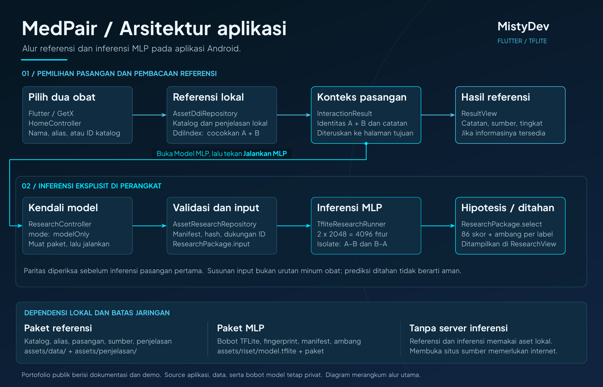

# Arsitektur MedPair — MistyDev

MedPair memakai **Flutter dan GetX** untuk antarmuka serta pengelolaan keadaan, dan **TensorFlow Lite** untuk inferensi MLP di perangkat Android. Penjelasan ini berasal dari tinjauan kode internal pada 10 November 2026. Source aplikasi, tes, paket referensi, dan bobot model dipertahankan secara lokal; repo publik menyajikan dokumentasi serta media.

## Alur utama

[Lihat PDF arsitektur](architecture/medpair-architecture.pdf)

Diagram mengikuti objek dan kelas yang ditinjau pada kode internal: pemilihan A/B menghasilkan `InteractionResult`, kemudian konteks itu diteruskan ke halaman hasil referensi atau halaman model. Diagram menggambarkan alur utama ketika paket valid; cabang kegagalan ditangani melalui pesan dan keadaan aplikasi. Nama komponen di bawah menjelaskan implementasi, tanpa menyertakan source aplikasinya.

| No. | Komponen pada diagram | Peran pada implementasi internal |
| --- | --- | --- |
| 1 | HomeController | Menyimpan pilihan A/B, menolak pasangan yang belum lengkap atau sama, lalu memanggil pemeriksaan referensi sebelum navigasi |
| 2 | AssetDdiRepository / DdiIndex | Memuat paket dan penjelasan, mencari katalog, serta mencocokkan pasangan dengan catatan sumber |
| 3 | InteractionResult | Membawa identitas kedua obat, konteks paket, dan hasil referensi ke halaman tujuan |
| 4 | ResultView | Menampilkan catatan, sumber, tingkat yang tersedia, dan batas informasi melalui widget hasil |
| 5 | ResearchController | Memuat paket riset; pada mode `modelOnly`, prediksi berjalan setelah tombol **Jalankan MLP** ditekan |
| 6 | AssetResearchRepository / ResearchPackage.input | Memeriksa integritas dan dukungan ID, lalu membentuk input untuk A–B dan B–A |
| 7 | TfliteResearchRunner | Memuat interpreter, memeriksa kontrak tensor, dan menjalankan inferensi melalui isolate |
| 8 | ResearchPackage.select / ResearchView | Memilih label berdasarkan ambang dan menampilkan hipotesis atau prediksi yang ditahan untuk setiap susunan |

## Pemisahan referensi dan model

Pencarian referensi tidak memicu inferensi. Rute Model MLP memakai mode `modelOnly`, sehingga pasangan yang sudah mempunyai catatan sumber tetap dapat dihitung tanpa mengganti catatan tersebut. Jalur riset lain mempertahankan mode `referenceFirst`, yang mendahulukan referensi bila tersedia.

`modelOnly` bukan jalur yang melewati kebutuhan paket referensi. `HomeController.openModel()` tetap menggunakan `inspect()` untuk membentuk `InteractionResult`, lalu meneruskannya ke halaman model. Karena itu, tersedianya source atau bobot model saja belum cukup untuk menjalankan seluruh alur tanpa paket lokal yang cocok.

Tombol **Jalankan MLP** pada `ResearchView` memanggil prediksi melalui controller. Membuka halaman model memuat kebutuhan paket, tetapi tidak otomatis menghasilkan hipotesis.

## Paket lokal dan sumber

| Paket | Isi dan kebutuhan |
| --- | --- |
| Referensi | Manifest, katalog, alias, catatan pasangan, jenis interaksi, dan metadata |
| Penjelasan | Manifest dan paket penjelasan yang sesuai dengan referensi |
| Riset MLP | Manifest, fingerprint, ambang per label, contoh paritas, dan bobot TFLite |

Ketiga paket tersebut merupakan dependensi lokal aplikasi dan tidak didistribusikan melalui repo publik. Fungsi referensi dan MLP membutuhkan paket yang sah serta saling cocok; implementasi tidak melewati validasi integritas untuk mengisi aset yang hilang.

Jalur referensi menampilkan catatan TDC/DrugBank serta tingkat DDInter ketika tersedia. Harvard Dataverse adalah lokasi berkas rujukan TDC/DrugBank. Tingkat seperti **Major** berasal dari DDInter, bukan prediksi tingkat keparahan oleh MLP. Identitas, snapshot sumber, dan draf teks tetap perlu dibaca dalam konteksnya.

Pembacaan referensi dan inferensi memakai aset lokal tanpa panggilan GPT/LLM pada alur tersebut. Membuka situs sumber memerlukan internet. Ini adalah penjelasan kode, bukan laporan pengujian jaringan atau offline baru.

## Kontrak inferensi

| Tahap | Perilaku pada source |
| --- | --- |
| Integritas | Memeriksa manifest, ukuran dan hash aset, serta kecocokan paket riset dengan manifest referensi |
| Dukungan pasangan | Kedua ID harus berbeda dan mempunyai fingerprint dalam paket riset |
| Input | Dua fingerprint masing-masing 2.048 fitur digabung menjadi tensor `float32` berukuran `[1, 4096]` |
| Keluaran | Tensor `float32` berukuran `[1, 86]`, berisi 86 skor jenis interaksi |
| Paritas | Paket harus mempunyai 16 contoh; sebelum inferensi pasangan pertama, runner membandingkan skor dan labelnya dengan acuan |
| Dua susunan | Menjalankan A–B dan B–A, dengan identitas obat dipertahankan pada tiap hasil |
| Seleksi | Label diterima hanya jika mempunyai ambang dan skornya mencapai ambang itu |

Pemeriksaan paritas dilakukan saat runner pertama kali disiapkan. Jika pemeriksaan gagal, runner tidak dipertahankan untuk menghasilkan hipotesis. Integritas dan paritas memeriksa kecocokan aset serta eksekusi, bukan ketepatan klinis.

Label tanpa ambang tidak diterima. Jika suatu susunan tidak menghasilkan label yang diterima, prediksinya ditahan. Satu susunan dapat menghasilkan hipotesis sementara susunan sebaliknya tidak, seperti contoh aspirin–warfarin dalam demo. **A–B dan B–A bukan urutan minum obat; prediksi ditahan tidak berarti aman.**

## Pemeriksaan dan batas distribusi

Pengujian lokal pada 10 November 2026 mencatat pengambilan dependensi dari cache selesai, analisis statis Flutter tanpa temuan, dan 64 tes unit/widget lulus. Laporan tersebut berasal dari kode internal; source dan suite tes tidak disertakan untuk dijalankan dari repo publik.

Tes memakai fixture. Hasil tersebut tidak mencakup build Android, pengujian paket data asli, inferensi MLP native pada perangkat, atau evaluasi klinis. Pengambilan dependensi dari cache juga tidak membuktikan perilaku aplikasi saat jaringan dimatikan.

Training dan ekspor paket berlangsung terpisah dari penggunaan Android. Source, dataset, paket referensi, bobot model, APK, cache, kredensial, dan konfigurasi mesin tidak disertakan dalam repo publik. Clone repo menyediakan dokumentasi dan media, bukan aplikasi yang dapat dibangun atau dijalankan. APK untuk unduhan publik belum disediakan; paket distribusi masih perlu diperiksa.

Model tidak menentukan dosis, tingkat DDInter, atau keamanan kombinasi. Langkah berikutnya adalah meninjau pemahaman calon pengguna, pencocokan identitas dan teks, serta evaluasi model pada data independen. Hasil uji pengguna belum dilaporkan dalam [studi kasus](STUDI-KASUS.md).
